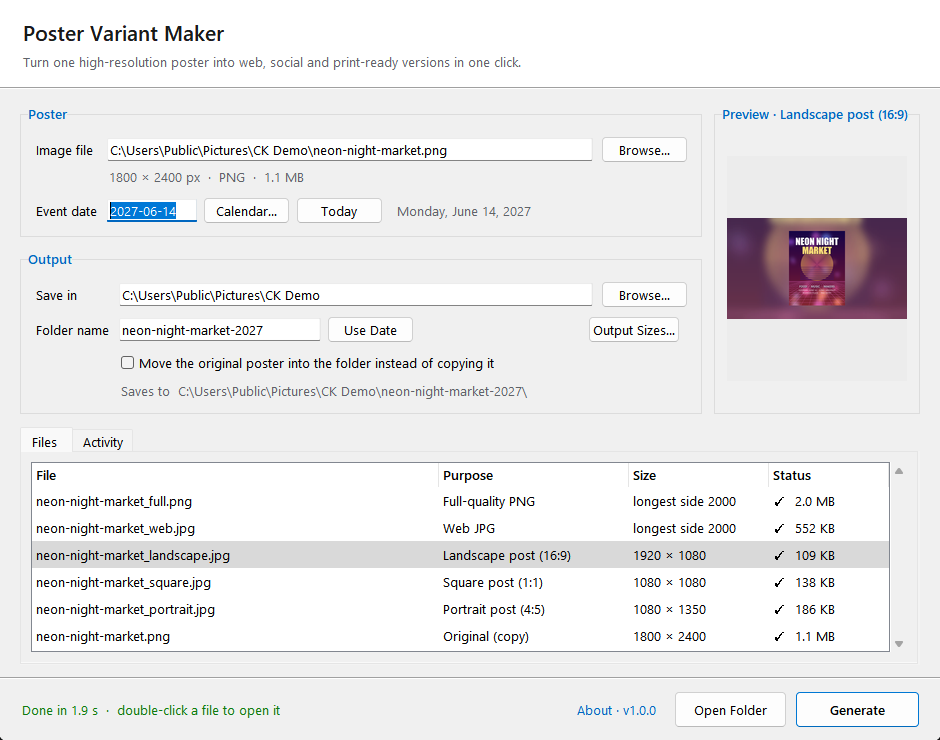
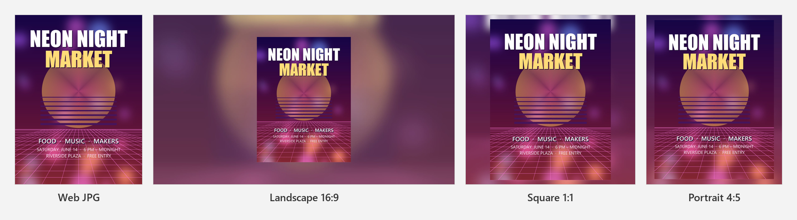
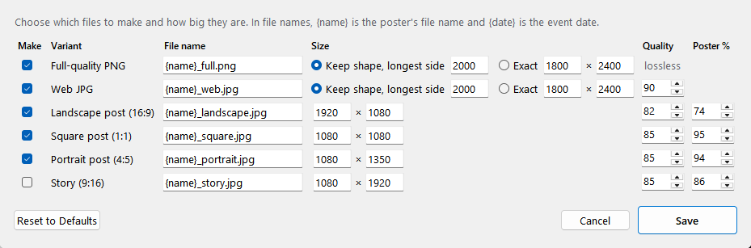

<p align="center">
  
</p>

<h1 align="center">CK Poster Variant Maker</h1>

<p align="center">
  Turn one poster into every version you need to share it:<br>full-quality PNG, web JPG and ready-to-post social images, in one click.
</p>

<p align="center">
  <a href="https://github.com/project-ceekay/ck-poster-variant-maker/releases/latest"></a>
  <a href="https://github.com/project-ceekay/ck-poster-variant-maker/releases"></a>
  
  <a href="LICENSE"></a>
</p>

<p align="center">
  <a href="https://github.com/project-ceekay/ck-poster-variant-maker/releases/latest"><b>Download</b></a> ·
  <a href="https://cksoftware.netlify.app/poster-variant-maker.html">Website</a> ·
  <a href="CHANGELOG.md">What's new</a> ·
  <a href="https://cksoftware.netlify.app/">More CK Software</a>
</p>



Part of the **CK Suite**, a set of small, free Windows tools by [CK Software](https://cksoftware.netlify.app/).

## What you get

From a single poster, the default set is:



| File | Size | Good for |
|---|---|---|
| Full-quality PNG | longest side 2000 px, keeps transparency | printing, archives, sending to venues |
| Web JPG | longest side 2000 px | websites, event listings, email |
| Landscape post | 1920 × 1080 (16:9) | Facebook, X, YouTube community posts, event pages |
| Square post | 1080 × 1080 | Instagram feed |
| Portrait post | 1080 × 1350 (4:5) | Instagram feed (takes the most screen space) |
| Story | 1080 × 1920 (9:16) | Instagram / Facebook stories (off by default) |

Every size, file name and quality setting can be changed in **Output Sizes…**, and any variant
can be switched off.



## Download

**[Download the latest version](https://github.com/project-ceekay/ck-poster-variant-maker/releases/latest)**:
get the `…-Setup.exe` file under *Assets* and run it.

- Windows 10 or 11 (64-bit). Installs for your user account only, so no administrator rights are needed.
- Windows may show **"Windows protected your PC"** because the installer isn't code-signed.
  Click **More info → Run anyway**.
- Uninstall any time from **Settings → Apps**.

## How to use it

1. **Choose a poster.** Drag an image onto the window, or click **Browse…** (PNG, JPG, TIFF, WebP).
2. **Set the event date.** It names the output folder; change the folder name if you prefer.
3. **Choose where to save**, then click **Generate** (or press **Ctrl+Enter**).

Click a social post in the **Files** list to preview it before generating. After it finishes,
double-click any file to open it. The original poster is copied into the folder too (or moved,
if you tick the option).

Colours are converted to sRGB for the web and social files, because most sites strip colour
profiles and anything else would look washed out once posted. The full-quality PNG keeps the
original profile.

## Updates

The program checks GitHub for a new version once a day. When one is available, a link appears
at the bottom of the window: click it to read what's new and update in one click. Your
settings are kept. You can turn the automatic check off under **About**.

Settings are stored in `%APPDATA%\CK Suite\Poster Variant Maker`.

## Run or build from source

Requires Python 3.10 or newer.

```
pip install -r requirements.txt
python program.py
```

To build the installer yourself: `pip install pyinstaller`, run the PyInstaller command from
[`.github/workflows/release.yml`](.github/workflows/release.yml), then compile
[`installer/setup.iss`](installer/setup.iss) with [Inno Setup](https://jrsoftware.org/isinfo.php).
Releases are built automatically by GitHub Actions when a version tag (`v1.2.3`) is pushed.

## License

[MIT](LICENSE) © CK Software. Bundled third-party components are listed in
[THIRD-PARTY-NOTICES.md](THIRD-PARTY-NOTICES.md).
